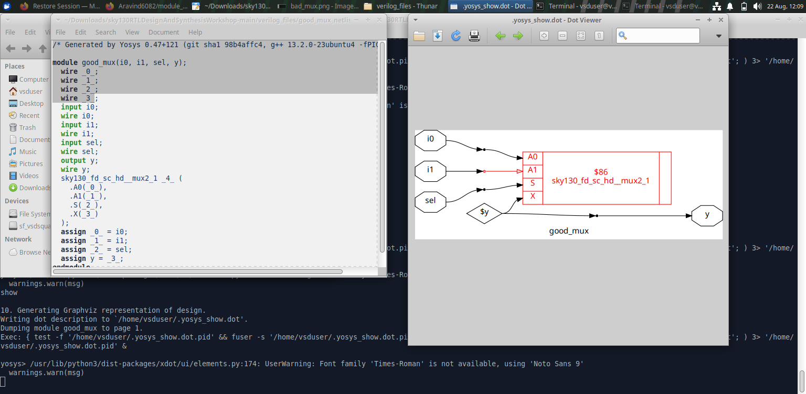
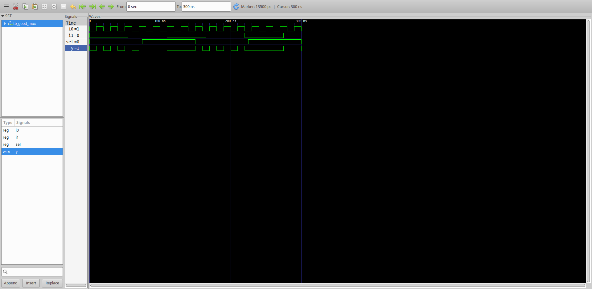

# Module 1 — RTL Design & Simulation

## Overview

Module 1 introduces the basic RTL design and verification flow using a simple 2:1 multiplexer (`good_mux`). The module demonstrates how an RTL description is simulated, how the resulting waveform is inspected, and how synthesis provides a hardware-oriented representation.

## Objectives

By completing this module, the learner should understand:

- The basic RTL design-to-synthesis flow.
- The role of a testbench in functional verification.
- How a 2:1 MUX behaves for different select values.
- How simulation waveforms are used to verify RTL behavior.
- How synthesis converts RTL into a structural hardware representation.

## RTL Design Flow

```text
RTL Design
    ↓
Testbench
    ↓
RTL Simulation
    ↓
Waveform / VCD
    ↓
Waveform Inspection
    ↓
Synthesis
    ↓
Hardware / Netlist Representation
```

## 1. Good MUX

The experiment uses a 2:1 multiplexer with two data inputs (`i0`, `i1`), a select signal (`sel`) and an output (`y`).

The expected behavior is:

```text
sel = 0  →  y = i0
sel = 1  →  y = i1
```



The figure represents the RTL/synthesized view of the MUX and provides a visual connection between the behavioral description and the resulting hardware.

## 2. RTL Simulation

The RTL design is verified with a testbench. The testbench provides different input and select combinations and observes the output.

Simulation is important because it checks the intended functionality before relying on the synthesized implementation.

The verification sequence is:

```text
Apply Inputs
    ↓
Apply Select
    ↓
Observe Output
    ↓
Compare With Expected MUX Behavior
```

## 3. Waveform Analysis

The simulation waveform is used to verify that the output follows the selected input.



When `sel` changes, the output should correspond to the selected input according to the MUX truth behavior. Waveform inspection therefore provides a direct visual check of the simulation results.

## 4. Synthesis

After functional verification, the RTL is synthesized. Synthesis transforms the RTL description into a hardware-oriented representation.


The synthesized view is useful for understanding that RTL is not simply software code; it describes hardware that can be mapped into logic structures.

## 5. Important Concepts

### RTL

Register Transfer Level (RTL) describes digital hardware behavior and the movement/processing of signals between registers and combinational logic.

### Testbench

A testbench provides stimulus to the design under test and observes the resulting outputs.

### Simulation

Simulation executes the RTL model to check functional behavior.

### Waveform

A waveform shows how signals change with simulation time and helps identify incorrect behavior.

### Synthesis

Synthesis converts RTL into a structural hardware representation suitable for implementation.

## 6. Key Learning

- RTL describes intended hardware behavior.
- A testbench is used to provide stimulus and verify outputs.
- Simulation should be performed before synthesis.
- Waveforms make signal behavior easy to inspect.
- A simple MUX is a useful starting point for understanding RTL design.
- Synthesis exposes the hardware-oriented structure inferred from RTL.

## Conclusion

Module 1 establishes the complete basic RTL workflow: design, testbench, simulation, waveform analysis and synthesis. The 2:1 MUX experiment provides a simple example through which the relationship between RTL behavior and synthesized hardware can be understood.
