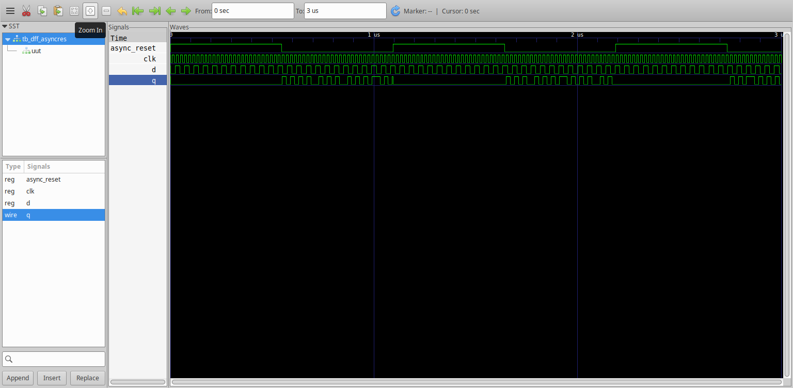
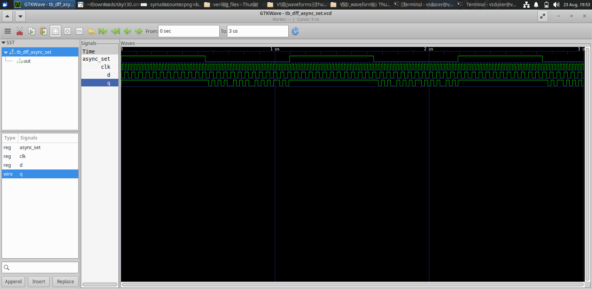
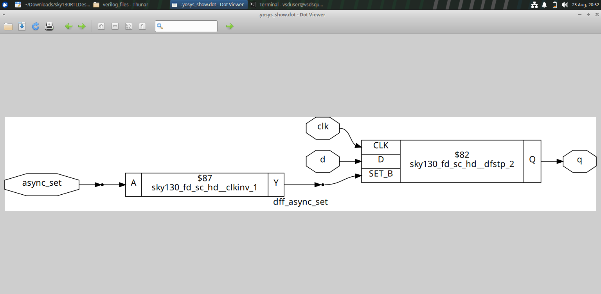
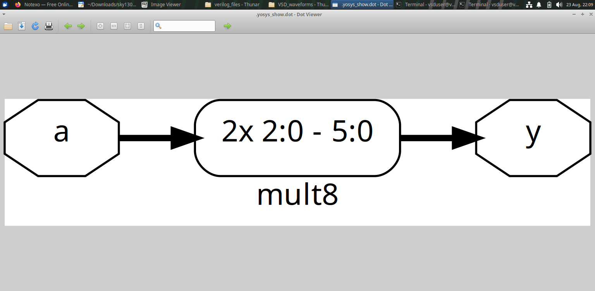
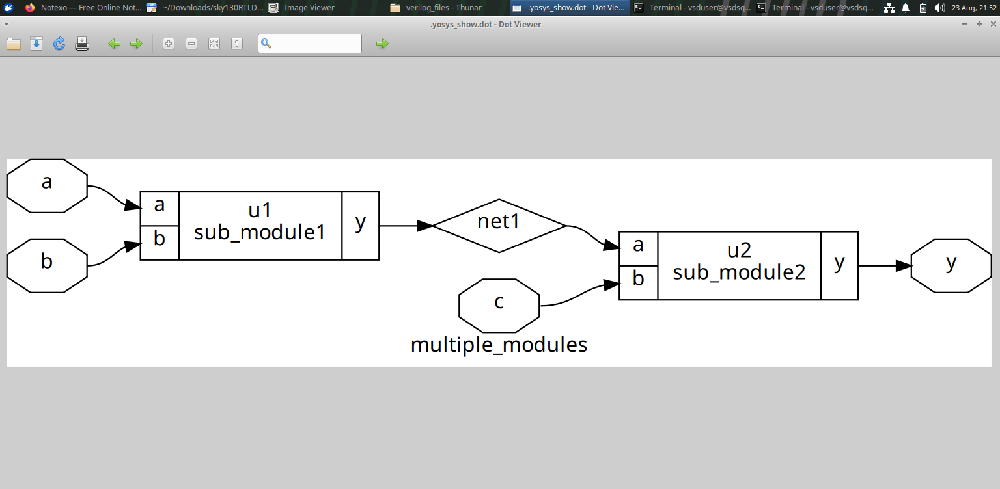
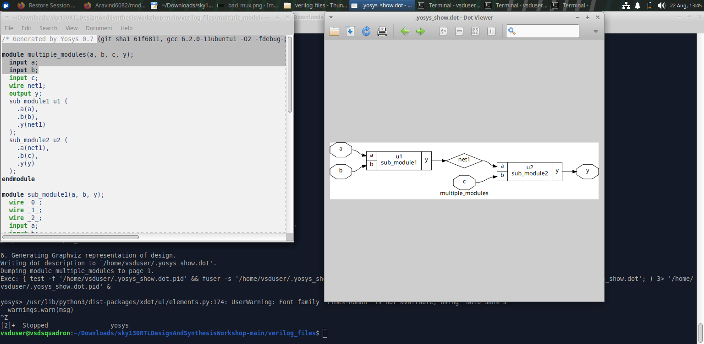

# Module 2 — Sequential Logic & RTL Synthesis

## Overview

Module 2 extends the RTL workflow from simple combinational logic to sequential logic and structural synthesis. The experiments cover D flip-flops with asynchronous controls, synthesized netlists, arithmetic synthesis and hierarchical RTL.

## Objectives

The module focuses on:

- D flip-flop based sequential logic.
- Asynchronous set and reset behavior.
- Synthesis of sequential RTL.
- Standard-cell/netlist representations.
- Constant multiplication synthesis.
- Hierarchical RTL design and multi-module structures.

## 1. D Flip-Flops

A D flip-flop is a sequential storage element. Unlike purely combinational logic, its output depends on clocked state and the applied control signals.

The supplied figures demonstrate DFF behavior and synthesized structures involving asynchronous controls.

### DFF Asynchronous Control Example



The waveform provides a visual representation of the sequential behavior and asynchronous control activity.

### Asynchronous Reset Structure



This figure shows the structural representation associated with the asynchronous reset experiment.

## 2. Synthesized DFF Structures

Synthesis maps the RTL description of sequential logic into structural hardware.




The netlist views help connect the original RTL description with the hardware cells selected during synthesis.

## 3. Asynchronous Controls

The module includes experiments involving asynchronous set/reset behavior.

The important observation is that control signals can influence the type and structure of the sequential hardware inferred during synthesis.

The general relationship is:

```text
Sequential RTL
     ↓
Clock + Data + Control
     ↓
Flip-Flop Inference
     ↓
Synthesis
     ↓
Mapped Sequential Structure
```

## 4. Multiplier Synthesis

The module also contains constant multiplication experiments.

### Multiply by 2


### Multiply by 8



These examples show how arithmetic RTL is represented after synthesis. Comparing different constant multipliers helps illustrate how the synthesis result can be expressed structurally.

## 5. Hierarchical RTL

Large RTL designs are commonly divided into smaller modules. The module includes examples showing a submodule and a design composed of multiple modules.

### Submodule


### Multiple Modules



### Hierarchical Comparison


### Synthesized Structural View



Hierarchical design improves organization by allowing a larger design to be built from reusable or logically separated modules.

## 6. Why Synthesis Results Matter

RTL describes the intended behavior, while the synthesized netlist shows how that behavior is represented structurally.

```text
RTL
 ↓
Logic / Sequential Inference
 ↓
Optimization and Mapping
 ↓
Netlist
```

Studying the synthesized output is therefore important when learning how coding constructs translate into actual hardware.

## 7. Key Learning

- Sequential RTL can infer flip-flop hardware.
- Asynchronous controls affect the inferred sequential structure.
- Synthesis converts RTL into structural/netlist representations.
- Arithmetic operations can produce optimized structural hardware.
- Hierarchical RTL allows complex designs to be divided into smaller modules.
- Comparing RTL and netlist views improves understanding of hardware inference.

## Conclusion

Module 2 builds on the basic RTL flow by introducing storage elements, asynchronous controls, arithmetic synthesis and hierarchical design. The supplied waveform and netlist figures provide practical evidence of how sequential and hierarchical RTL is translated into hardware structures.
