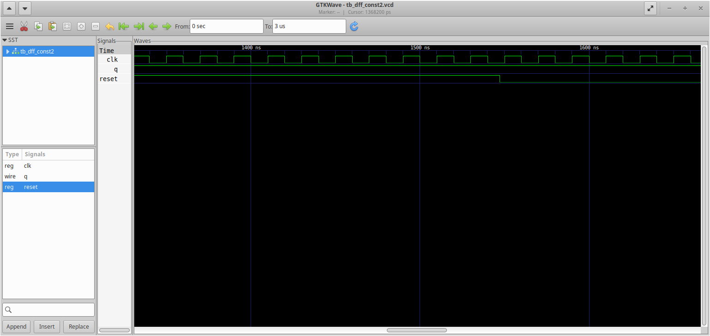
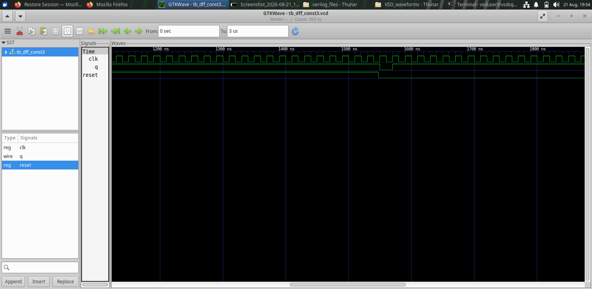
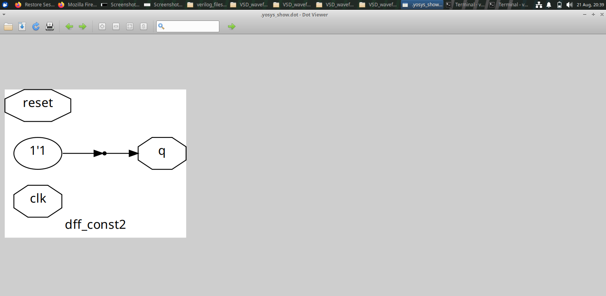
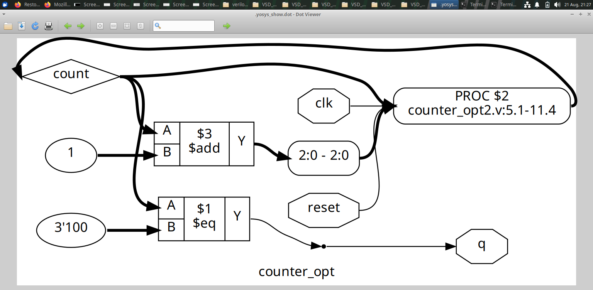
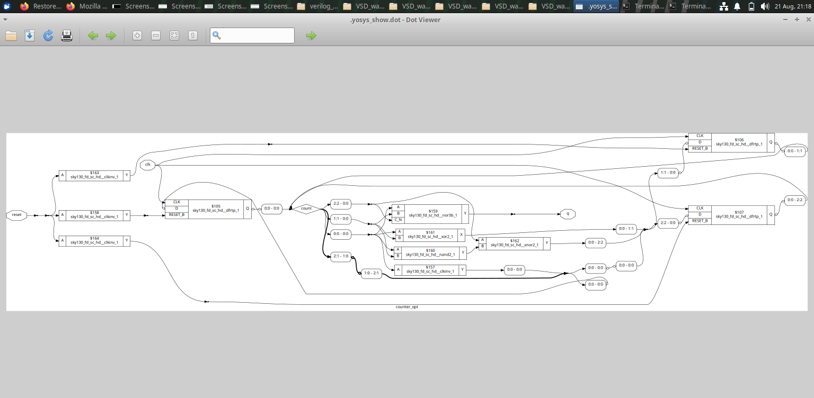

# Day_3— Combinational & Sequential Optimization

## Overview

Module 3 focuses on synthesis optimization and demonstrates how constants, redundant logic and sequential structures can be simplified during synthesis. The experiments also include counter-related optimization.

## Objectives

The main objectives are to understand:

- How synthesis optimizes constant logic.
- How redundant or unnecessary logic can be simplified.
- How sequential logic can be optimized.
- How counter structures are represented after synthesis.
- Why the synthesized result should be inspected instead of assuming that the RTL structure is preserved exactly.

## Optimization Flow

```text
RTL
 ↓
Logic Inference
 ↓
Constant Propagation / Simplification
 ↓
Optimization
 ↓
Synthesized Hardware
```

The important point is that synthesis attempts to preserve the required functionality while simplifying the implementation.

## 1. Constant Optimization

When a signal or expression is fixed to a constant, synthesis can use that information to simplify the surrounding logic.






These figures document the constant-related experiments and the resulting optimized structures.

### Observation

Constant values can reduce the amount of logic required because the synthesis process does not need to implement behavior that has become fixed.

## 2. Sequential Optimization

Optimization is not limited to combinational logic. Sequential structures can also be simplified depending on the RTL description and the required functionality.





These figures provide examples of synthesized sequential structures associated with the optimization experiments.

## 3. Counter Optimization

Counters are sequential circuits whose state changes according to clocked behavior.





The counter figures help demonstrate how sequential RTL is represented after synthesis and how synthesis can simplify or restructure the implementation.

## 4. RTL vs Synthesized Hardware

A key lesson from this module is that the synthesized hardware does not necessarily look identical to the original RTL.

```text
RTL Structure
      ↓
Inference
      ↓
Optimization
      ↓
Different / Simplified Hardware Structure
```

The final hardware representation should therefore be examined when studying synthesis behavior.

## 5. Practical Observations

- Fixed constants can enable logic simplification.
- Unnecessary logic may be removed or reduced.
- Sequential logic can also undergo synthesis optimization.
- Counter implementations can be represented in optimized structural form.
- The functional intent is preserved even when the structural representation changes.

## 6. Key Learning

- Synthesis performs optimization automatically.
- Constant propagation can reduce hardware.
- Sequential structures can also be optimized.
- RTL structure and synthesized structure are not always identical.
- Netlist inspection is an important part of understanding synthesis.

## Conclusion

Module 3 demonstrates that synthesis is more than a direct translation of RTL into gates. The synthesis process analyzes the RTL, applies optimization and produces a structural implementation that preserves the required behavior while reducing unnecessary hardware where possible.
