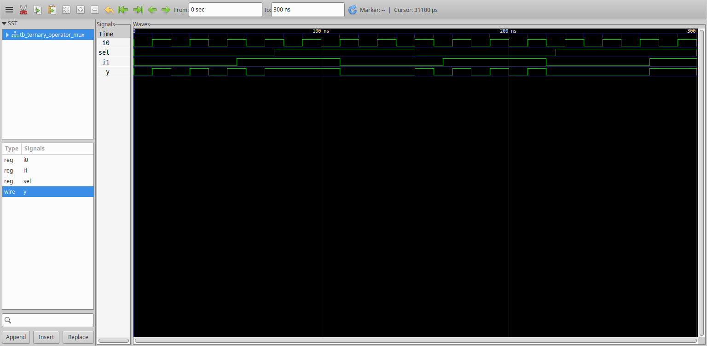
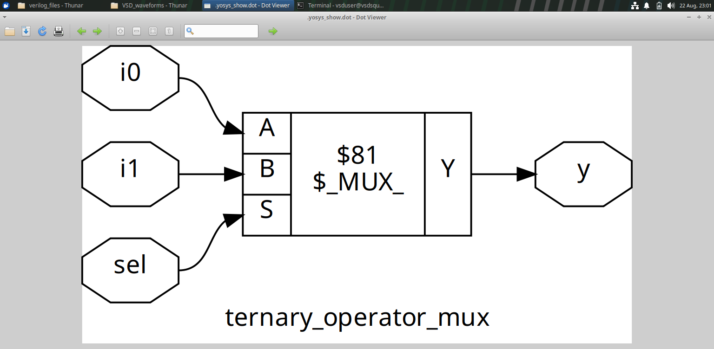
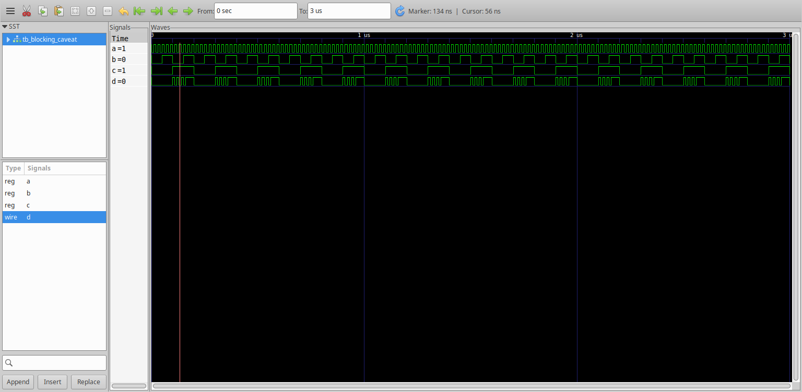
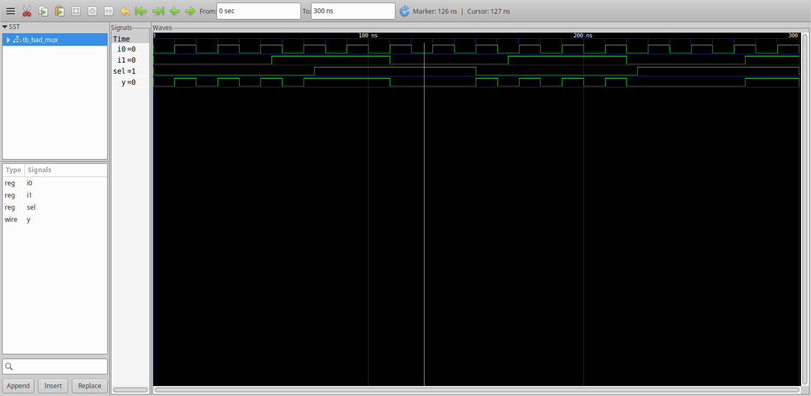
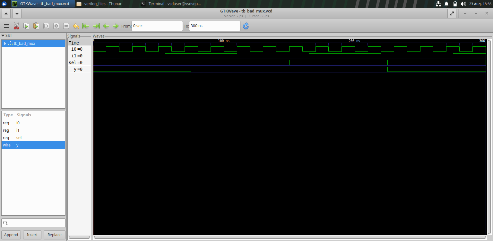
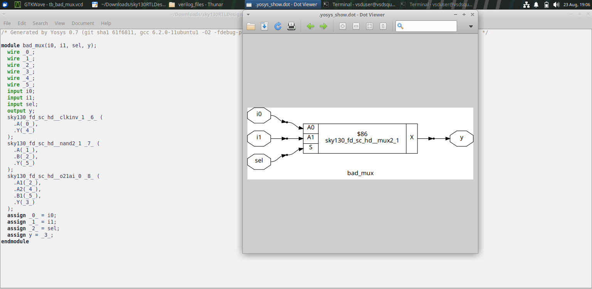

# Module 4 — GLS, Blocking vs Non-Blocking & Synthesis Simulation

## Overview

Module 4 studies how RTL coding style influences inferred hardware and how synthesized designs can be verified through gate-level simulation (GLS). The experiments include MUX coding styles, blocking-assignment behavior and synthesized results.

## Objectives

This module aims to understand:

- Different ways of describing a MUX in RTL.
- The relationship between coding style and inferred hardware.
- The role of blocking and non-blocking assignments.
- Why synthesized hardware should be verified.
- The purpose of gate-level simulation.

## 1. MUX Coding With a Ternary Operator

A multiplexer can be described using the ternary operator.



The synthesized representation is shown below.



The comparison demonstrates how a compact RTL expression can correspond to a hardware MUX structure after synthesis.

## 2. Blocking Assignment Caveat

The module includes a blocking-assignment coding example.



Blocking assignments execute in procedural order, so the ordering of statements can affect the behavior being modeled. This is especially important when describing sequential or combinational behavior.

## 3. Synthesized Blocking-Assignment Structure

The resulting synthesized representation is shown below.


Studying both the RTL example and the netlist helps identify how the coding style is interpreted by synthesis.

## 4. Bad / Incomplete MUX Example

The module also contains a MUX example that demonstrates an undesirable or incomplete coding style.







These figures are useful for comparing the intended MUX behavior with the hardware structure inferred from the RTL.

## 5. Gate-Level Simulation

Gate-level simulation connects synthesis results back to verification.

```text
RTL
 ↓
RTL Simulation
 ↓
Synthesis
 ↓
Gate-Level Netlist
 ↓
Gate-Level Simulation
 ↓
Waveform / Behavior Comparison
```

RTL simulation verifies the behavioral description, while GLS verifies the synthesized netlist representation.

## 6. Blocking vs Non-Blocking

The choice of procedural assignment is important in RTL design.

- **Blocking assignment (`=`)** updates a variable immediately within the procedural flow.
- **Non-blocking assignment (`<=`)** schedules an update and is commonly associated with clocked sequential modeling.

The module's blocking-assignment experiment highlights why coding style should match the intended hardware behavior.

## 7. Key Learning

- A MUX can be described using different RTL coding styles.
- Coding style can influence the inferred hardware.
- Blocking and non-blocking assignments have different procedural behavior.
- RTL simulation is not the only verification stage.
- Gate-level simulation provides a way to verify synthesized hardware behavior.
- Netlist inspection reveals the actual structural implementation.

## Conclusion

Module 4 connects RTL coding style, synthesis and gate-level verification. The experiments demonstrate that writing RTL is not only about obtaining the correct simulation result; the coding style should also produce the intended synthesizable hardware, which should then be checked through synthesis and GLS.
