# Day_5 — Optimization in Synthesis

## Overview

Module 5 focuses on synthesis behavior for incomplete and complete combinational descriptions, MUX/DEMUX structures, `generate` constructs and a ripple-carry-adder related design.

## Objectives

The module demonstrates:

- The effect of incomplete `if` assignments.
- The difference between incomplete and complete `case` descriptions.
- MUX and DEMUX inference.
- Repeated hardware generation using `generate`.
- Structural representation of a ripple-carry-adder related design.
- Why complete combinational assignments are important for predictable synthesis.

## 1. Incomplete `if`

A combinational block should assign its output for all required input conditions. An incomplete assignment can cause storage behavior to be inferred.

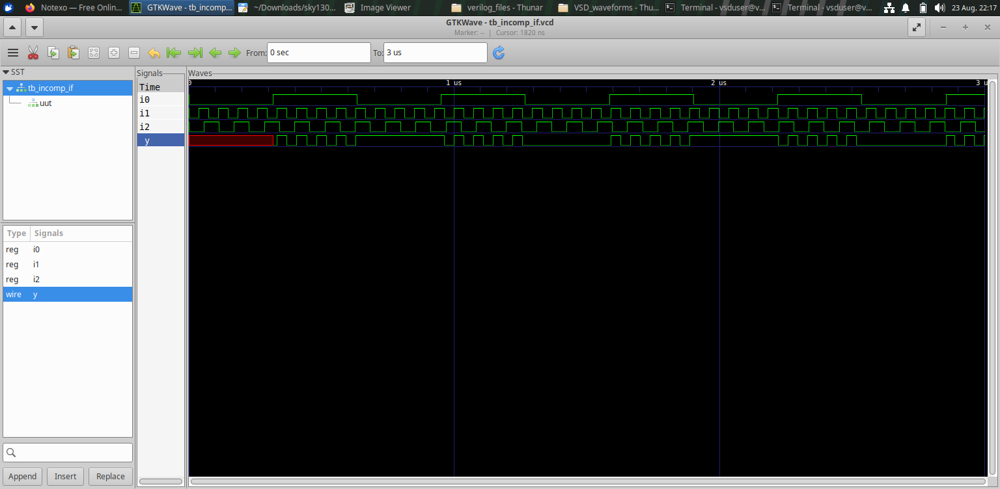

### Synthesized Result

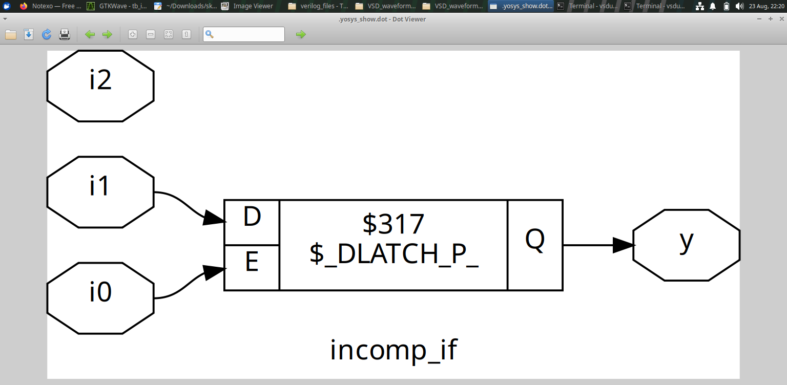

A second incomplete-IF experiment is also included.

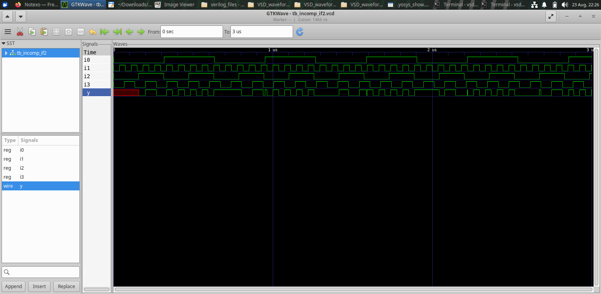

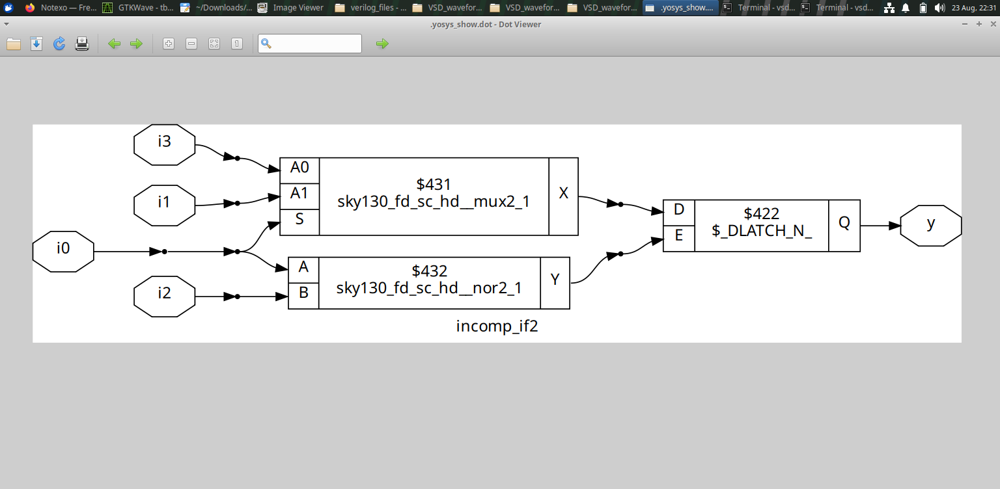

### Main Observation

When a combinational output is not assigned for every required condition, synthesis may infer storage behavior rather than pure combinational logic.

## 2. Incomplete and Complete `case`

The module compares different `case` descriptions.

### Incomplete Case

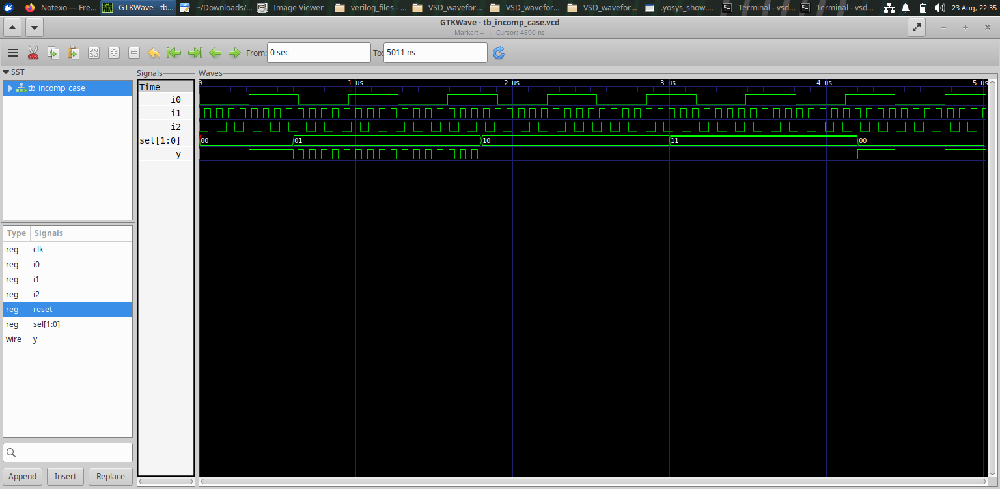

### Incomplete Case Netlist

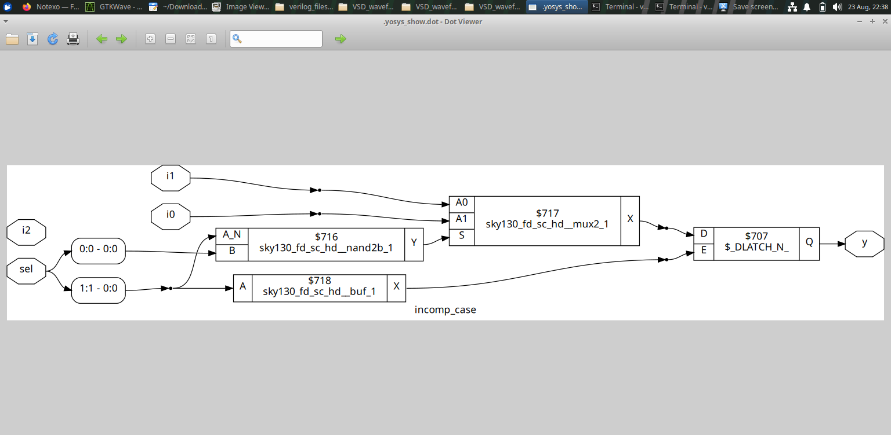

### Bad Case


### Complete Case

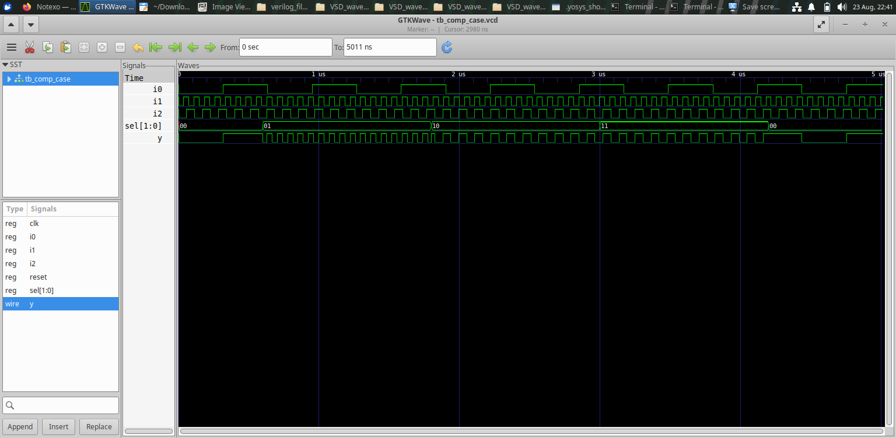

### Complete Case Netlist

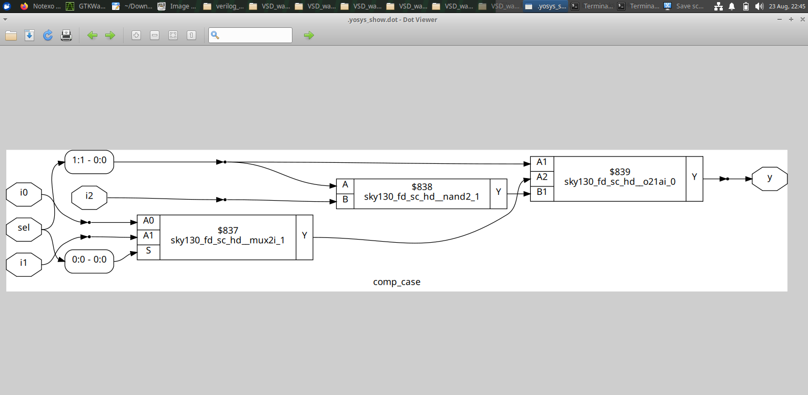

### Partial Case Assignment

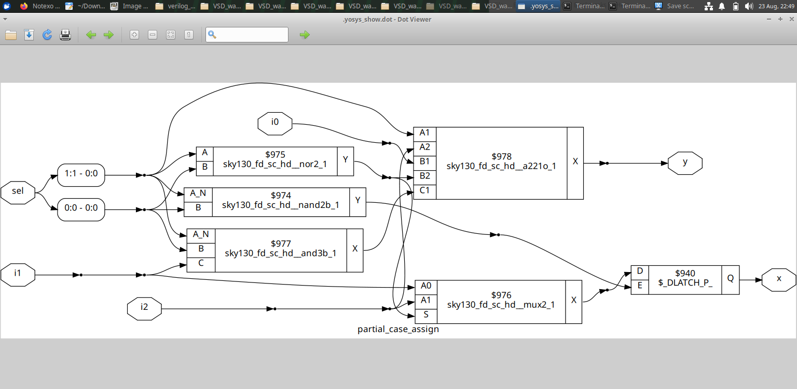

These experiments show that the completeness of assignments is important when describing combinational hardware.

## 3. MUX and DEMUX

Selection and routing structures can be described directly in RTL.

### DEMUX Using Case

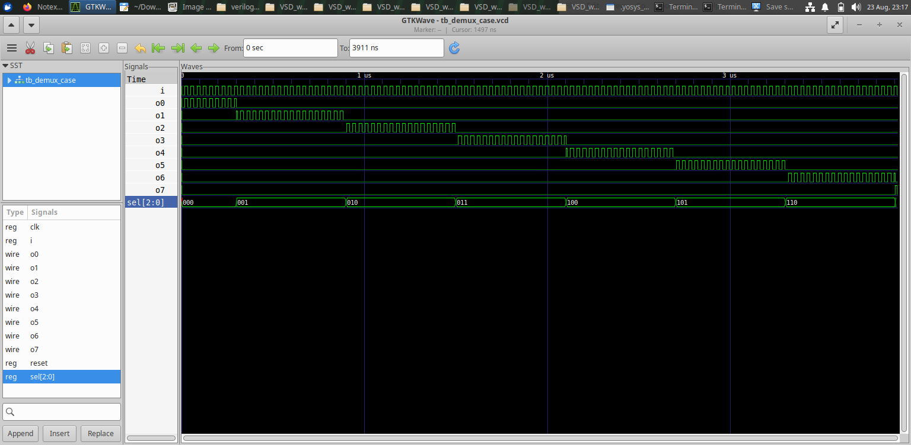

A DEMUX routes an input toward one of multiple outputs according to a selection/control signal.

The supplied figure provides the structural example used in the module.

## 4. Generate Constructs

The `generate` construct is useful for describing repeated or systematically created hardware.

### MUX Generate

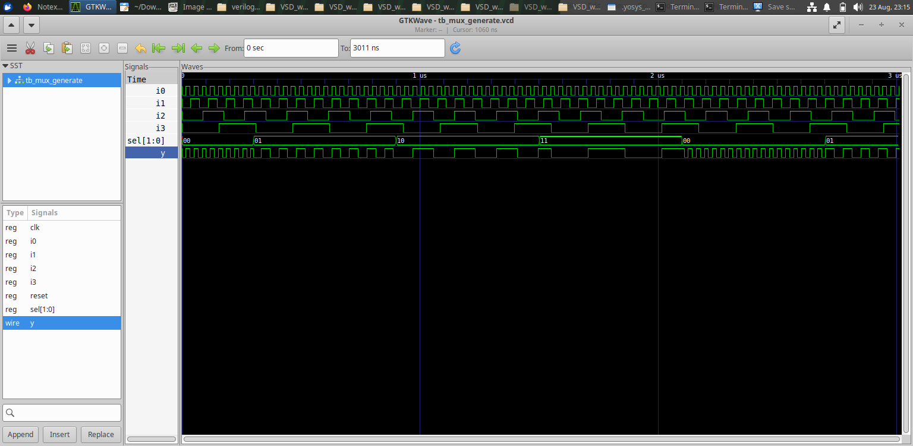

### DEMUX Generate


The figures demonstrate how repeated structures can be expressed systematically rather than writing every repeated hardware instance manually.

## 5. Ripple Carry Adder

The module also contains a ripple-carry-adder related structure.

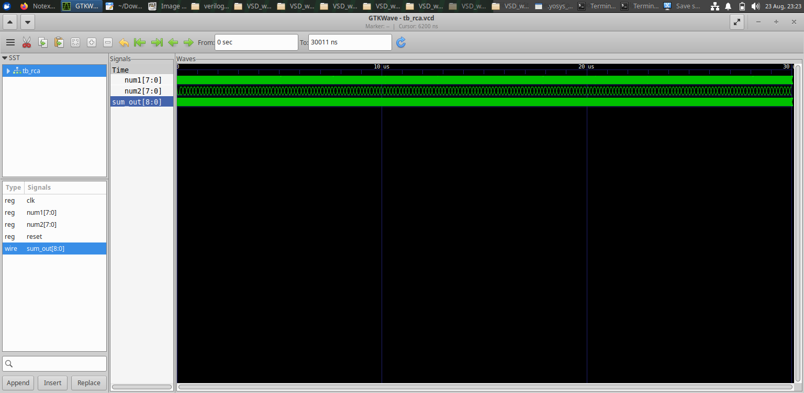

A ripple-carry structure is built from multiple adder stages in which carry information propagates from one stage to the next.

## 6. Complete vs Incomplete Combinational RTL

The main design principle illustrated by this module is:

```text
Complete Assignment
        ↓
Predictable Combinational Logic

Incomplete Assignment
        ↓
Possible Storage / Latch Inference
```

Therefore, when combinational logic is intended, the RTL should describe the required output behavior for all relevant conditions.

## 7. Key Learning

- Incomplete combinational descriptions can infer latches/storage behavior.
- Complete `if` and `case` descriptions are important for combinational RTL.
- MUX and DEMUX structures can be inferred from selection logic.
- `generate` constructs help describe repeated hardware.
- Netlist inspection shows the hardware inferred from RTL.
- Coding completeness has a direct impact on synthesis results.

## Conclusion

Module 5 demonstrates several important synthesis concepts through practical RTL examples. The incomplete `if`/`case` experiments emphasize complete combinational assignments, while the MUX/DEMUX, `generate` and ripple-carry-adder examples show how structural hardware can be described and synthesized from RTL.
