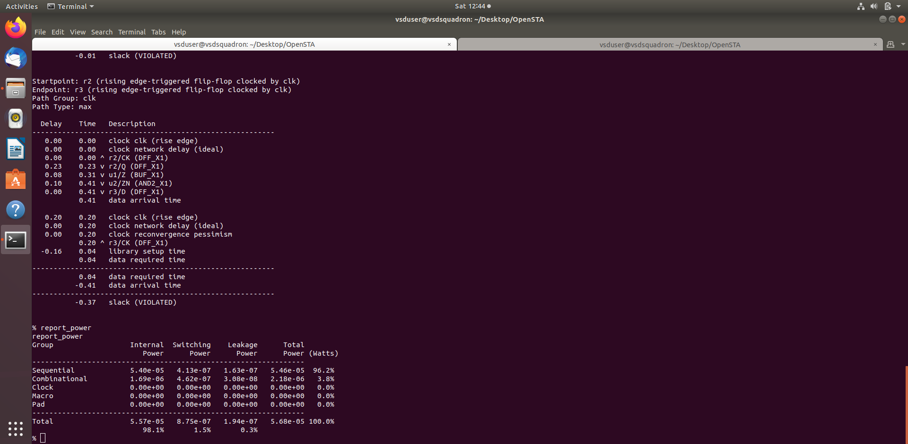
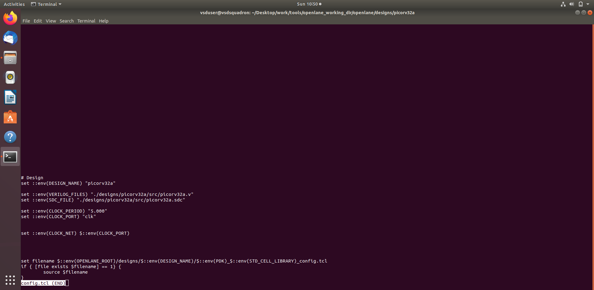
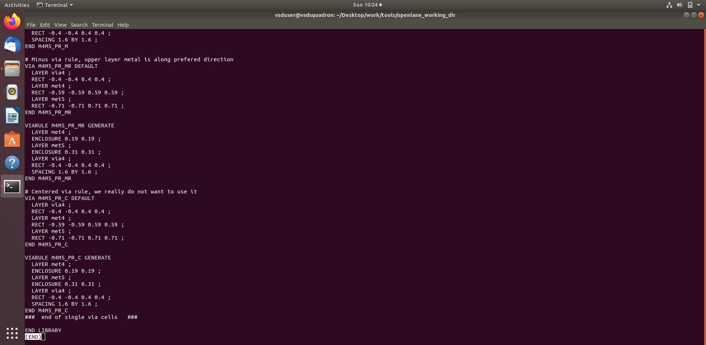
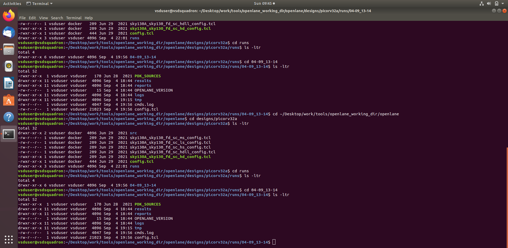
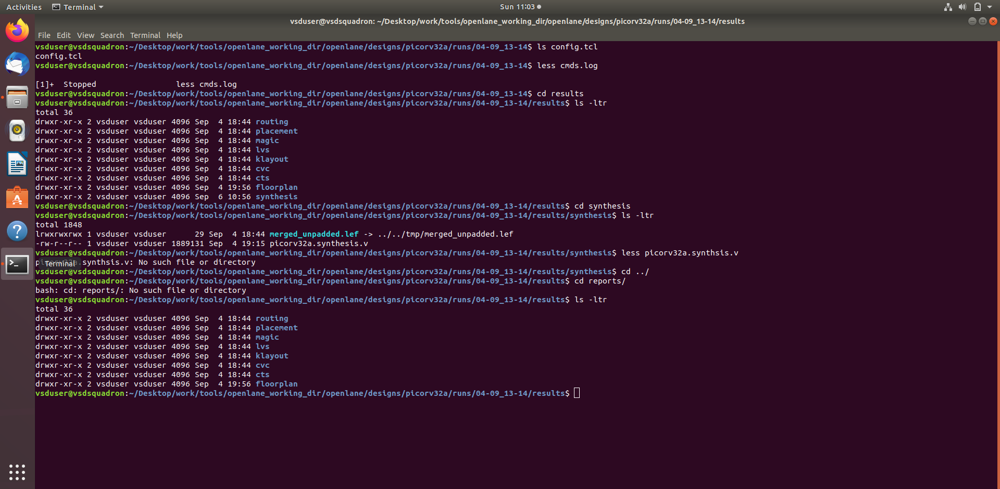
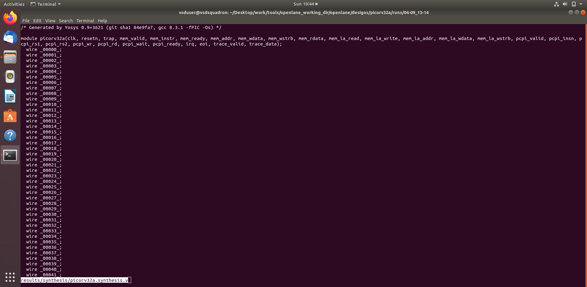
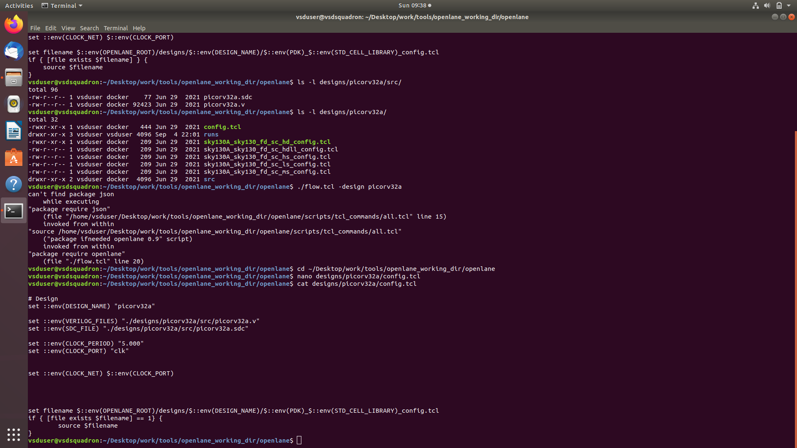
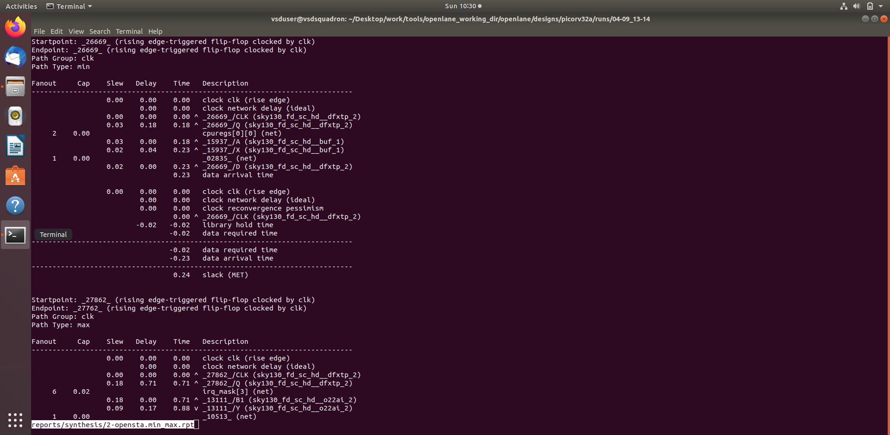
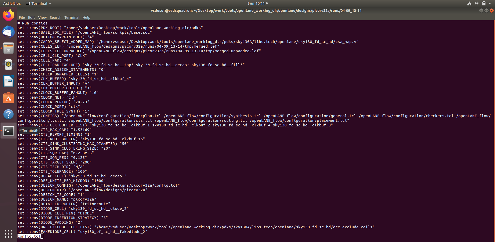
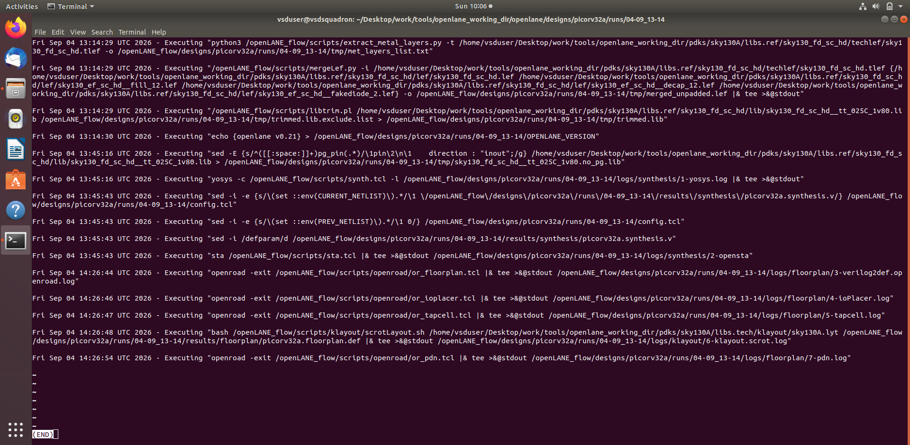

# MODULE 6 — RTL Design Workshop

## OpenLane, Sky130, Synthesis and Static Timing Analysis (STA)

### 1. Objective

Module 6 covers the RTL-to-synthesis and timing-analysis stage of the ASIC design flow. The work uses the PicoRV32A design and the OpenLane/Sky130 environment represented in the supplied evidence.

This README is created directly from the files contained in the uploaded repository package. The supplied files are retained without changing their content.

### 2. Topics Covered

- OpenLane environment and configuration
- Sky130 technology information
- LEF / merged LEF information
- PicoRV32A design configuration
- Synthesis configuration
- Synthesis results and reports
- Synthesized netlist
- Design statistics
- OpenSTA static timing analysis
- Timing-analysis concepts
- RTL-to-synthesis-to-STA flow

### 3. RTL-to-STA Flow

```text
RTL Design
    ↓
Design / OpenLane Configuration
    ↓
Sky130 Technology Files
    ↓
Synthesis
    ↓
Synthesized Netlist
    ↓
Synthesis Reports & Statistics
    ↓
OpenSTA / Static Timing Analysis
```

### 4. Supplied Evidence

### 1. `less_merged222.png`



### 2. `sky130_tcll22.png`



### 3. `less_merged23.png`



### 4. `design_picorva22.png`



### 5. `synthesis_report22.png`



### 6. `picorv32a_syn_net22.png`



### 7. `config_tcl22.png`



### 8. `opensta_report22.png`



### 9. `picorv32a stats22.png`


### 10. `less_config22.png`



### 11. `less_cmnd-tcl22.png`




### 5. Key Learning

1. Understand how an RTL design is prepared for an ASIC implementation flow.
2. Understand the purpose of technology files and LEF information.
3. Review design and OpenLane configuration.
4. Understand synthesis and synthesized-netlist output.
5. Interpret synthesis reports and design statistics.
6. Understand the purpose of Static Timing Analysis.
7. Relate timing constraints and implementation results.

### 6. Evidence Integrity

The screenshots and files shown in this module are taken from the uploaded repository package. No screenshot, report, measurement, or execution result has been fabricated.

### 7. Conclusion

Module 6 establishes the synthesis and timing-analysis foundation of the RTL-to-GDSII flow. It connects RTL configuration and technology information with synthesis, generated netlist information and STA.
