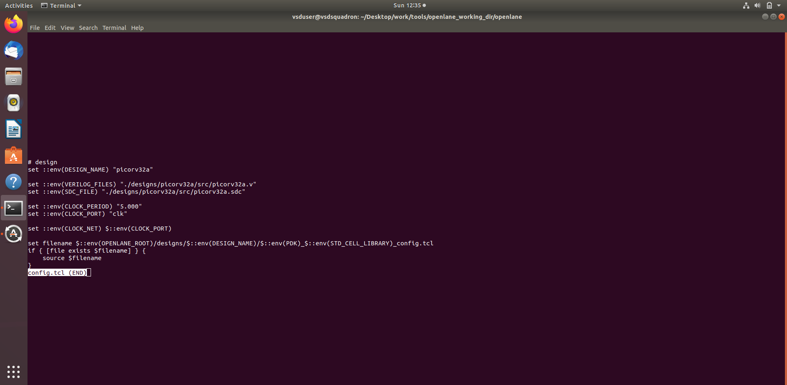
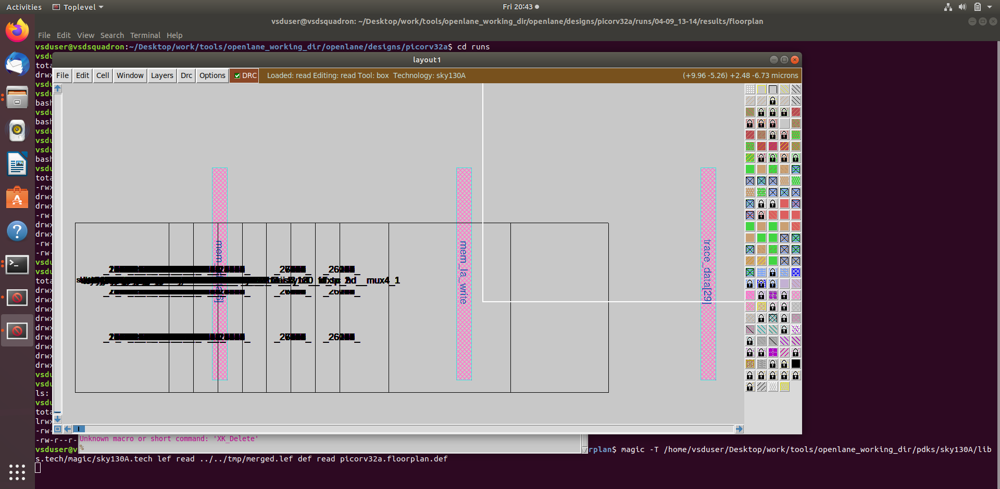
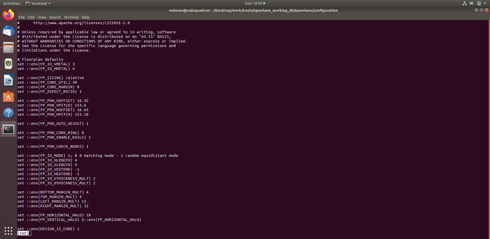
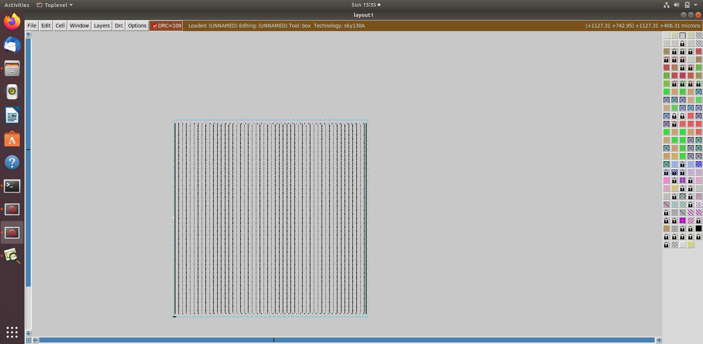

# MODULE 7 — RTL Design Workshop

## Physical Design, Floorplanning, Layout and PDN

### 1. Objective

Module 7 covers the physical-design portion of the ASIC implementation flow. The supplied evidence focuses on floorplan configuration, physical layout generation, Magic layout inspection and power-distribution-network (PDN) results.

This README is created directly from the files contained in the uploaded repository package. The supplied files are retained without changing their content.

### 2. Topics Covered

- Physical-design configuration
- Floorplan configuration
- Core and die planning
- Layout generation
- Layout inspection using Magic
- Power Distribution Network (PDN)
- Physical implementation concepts
- Relationship between configuration and physical layout

### 3. Physical-Design Flow

```text
Synthesized Design
       ↓
Physical-Design Configuration
       ↓
Floorplanning
       ↓
PDN Generation
       ↓
Physical Layout
       ↓
Magic / Layout Inspection
```

### 4. Supplied Evidence

### 1. `config_tcls22.png`



### 2. `pdn22.png`



### 3. `config.tcl floorplans22.png`


### 4. `floorplan22.png`



### 5. `floor_planlayoutmagic22.png`



### 6. `LAYOUT_IN_MAGIC22.png`


### 5. Key Learning

1. Understand the transition from synthesized logic to physical implementation.
2. Understand the purpose of floorplanning.
3. Relate floorplan configuration to physical layout.
4. Understand the purpose of the power-distribution network.
5. Inspect physical layout using a layout viewer.
6. Understand how physical-design configuration affects implementation.

### 6. Evidence Integrity

The screenshots and files shown in this module are taken from the uploaded repository package. No screenshot, report, measurement, or execution result has been fabricated.

### 7. Conclusion

Module 7 demonstrates the transition from synthesized design data to physical implementation through floorplanning, PDN and layout inspection. These stages provide the foundation for later placement, clock-tree synthesis and routing.
