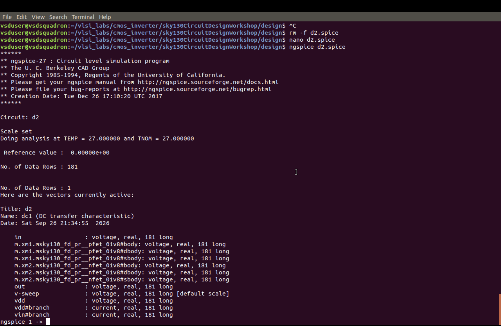
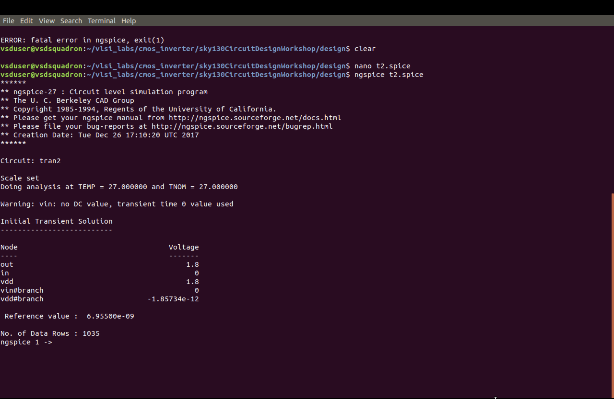
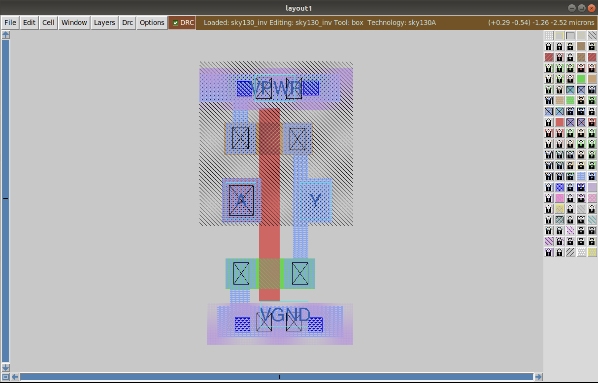
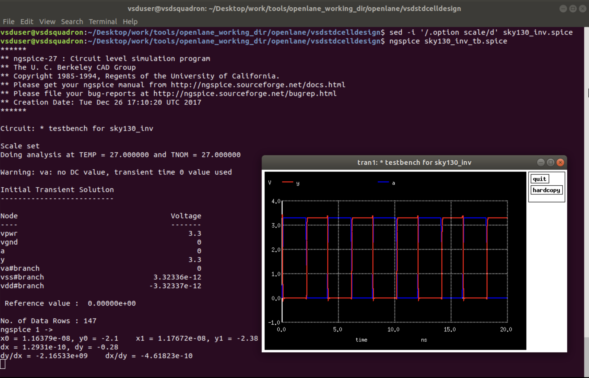
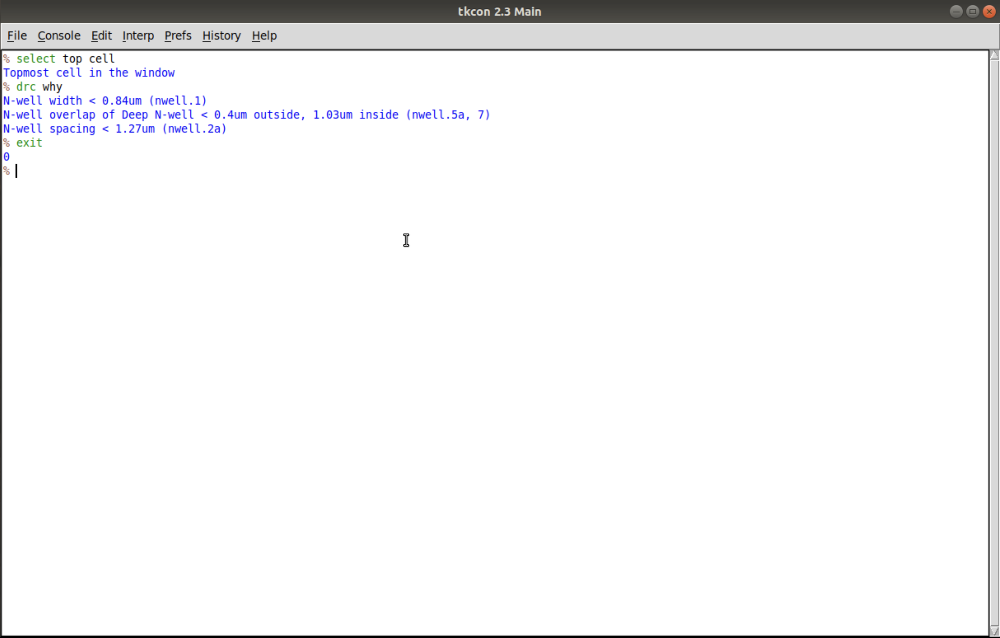

# Module 8: CMOS Inverter Characterization and Magic Layout

This module explores a CMOS inverter using the SkyWater SKY130 process design kit (PDK). The workflow covers transistor-level simulation with ngspice, physical layout inspection in Magic, extracted-netlist simulation, and design-rule-check (DRC) experiments.

> **Reference and attribution:** This README is a reorganized learning guide based on the RTL Design Workshop materials. Source repository: https://github.com/shivashankar089/RTL_Design_Workshop. Retain any attribution required by the source license and your course rules. Screenshots are reference evidence unless you captured them during your own run.

## 1. Module Overview

### 1.1 SKY130_D3_SK1 — SPICE Decks and ngspice Simulation

Two CMOS inverter sizing cases are compared:

| Case | PMOS width | NMOS width |
|---|---:|---:|
| `d1` | 0.84 µm | 0.36 µm |
| `d2` | 2.10 µm | 0.36 µm |

DC sweeps generate voltage-transfer characteristics (VTCs). Transient simulations use a pulsed input to examine inverter switching. Compare the curves and waveforms directly; the actual switching point and delay should be inferred from the simulation results rather than assumed.

### 1.2 SKY130_D3_SK2 — Magic Layout and Extracted-Netlist Simulation

The inverter layout is opened in Magic with the Sky130A technology setup. A SPICE netlist is extracted from the physical layout and simulated to check whether the extracted circuit preserves the expected inverter behavior. Parasitic effects depend on the extraction settings used.

### 1.3 SKY130_D3_SK3 — Poly and Nwell DRC Experiments

Poly and nwell test layouts are inspected in Magic. DRC messages are compared with the corresponding geometries to understand the technology rules and identify intentional rule violations.

## 2. Learning Objectives

- Create and run ngspice decks for a CMOS inverter using SKY130 device models.
- Generate and interpret DC voltage-transfer characteristics for two sizing cases.
- Explain how changing PMOS width can affect the inverter's switching behavior.
- Compare pulsed-input transient responses.
- Inspect an inverter layout in Magic and simulate its extracted netlist.
- Interpret Magic DRC messages for poly and nwell test geometries.

## 3. Workflow

1. Prepare the two inverter SPICE decks.
2. Run DC and transient analyses in ngspice.
3. Compare the `d1` and `d2` results.
4. Open or create the inverter layout in Magic.
5. Extract the layout netlist and run a transient simulation.
6. Inspect the poly and nwell DRC examples.
7. Record observations from the actual simulator output.

## 4. Simulation and Layout Evidence

The image references below use the filenames supplied with the module. Keep these images in the same directory as this README, or update the relative paths if you store them elsewhere.

### SKY130_D3_SK1 — SPICE Decks and Simulation

#### 4.1 First inverter SPICE deck — `d1_spice.png`

Case `d1` uses a PMOS width of 0.84 µm and an NMOS width of 0.36 µm. It serves as the baseline sizing configuration.

#### 4.2 First-case DC transfer characteristic — `d1_plot_in_vs_out.png`

The plot shows output voltage as input voltage is swept. Inspect the transition region and use the plotted axes to estimate the switching point.

#### 4.3 Second inverter SPICE deck — `d2_spice.png`

Case `d2` increases the PMOS width to 2.10 µm while keeping the NMOS width at 0.36 µm.

#### 4.4 Second-case DC transfer characteristic — `d2_plot_in_vs_out.png`

Compare the transition region and switching point with the `d1` plot. Describe any change based on the measured graph.

#### 4.5 ngspice console — `ng_spice.png`

This image documents the ngspice session and its displayed analysis output.

#### 4.6 Initial d1 transient response — `ngspice_transcient1.png`

A pulsed input is applied to the `d1` inverter. Check that the output is inverted relative to the input and inspect the edge timing.

#### 4.7 d1 transient plot — `SKY_D3_SK1_L4_transient_t1.png`

Use this plot alongside the previous `d1` transient image to inspect the input pulse and inverted output.

#### 4.8 Initial d2 transient response — `ngspice_transcient2.png`

This is the pulsed-input response for the wider-PMOS `d2` case. Compare the output transitions with `d1`.

#### 4.9 d2 transient plot — `SKY_D3_SK1_L4_transient_t2.png`

Compare this plot with the `d1` result and describe the observed difference using the waveform and time axis.

### SKY130_D3_SK2 — Magic Layout and Extracted Simulation

#### 4.10 Inverter layout — `SKY_D3_SK2_L1_inverter_layout_magic.png`

The Magic view shows the inverter's device and interconnect geometry, including power, ground, input, and output connections.

#### 4.11 Extracted-layout transient simulation — `SKY_D3_SK2_L4_transient_output_layout_extracted.png`

After extracting the layout netlist in Magic, simulate the extracted circuit and check that its output behaves as an inverter. The parasitic effects represented depend on the extraction configuration.

### SKY130_D3_SK3 — Poly and Nwell DRC Experiments

#### 4.12 Poly test layout — `SKY_D3_SK3_L1_poly_drc_layout.png`

Inspect the poly geometries in Magic and identify the regions used to demonstrate the technology rules.

#### 4.13 Poly DRC output — `SKY_D3_SK3_L1_poly_drc_log.png`

Relate the messages shown in the DRC output to the geometry in the poly test layout. Confirm each reported rule against the actual tool output.

#### 4.14 Nwell test layout — `SKY_D3_SK3_L2_nwell_drc_layout.png`

Inspect the nwell shapes and compare the intended compliant and non-compliant geometries.

#### 4.15 Nwell DRC output — `SKY_D3_SK3_L2_nwell_drc_check.png`

Compare the reported nwell checks with the layout. Record the rule messages actually reported by Magic.

## 5. Results and Observations

Complete this section using results from your own simulation and layout run:

- **DC sweep:** Record the observed switching point for `d1` and `d2`.
- **Transient analysis:** Compare the rise and fall behavior visible in the two cases.
- **Extracted netlist:** State whether the extracted circuit retained inverter behavior and note the extraction settings.
- **Poly DRC:** List the violations reported by Magic and the geometry associated with each.
- **Nwell DRC:** List the violations reported by Magic and the geometry associated with each.

Do not report values or claim a successful run unless they are supported by your own output or the cited reference evidence.

## 6. Summary

This module follows a CMOS inverter from transistor-level simulation to physical layout. The DC and transient analyses help compare two sizing configurations. Magic is then used to inspect the layout, simulate an extracted netlist, and study poly and nwell design-rule checks.

