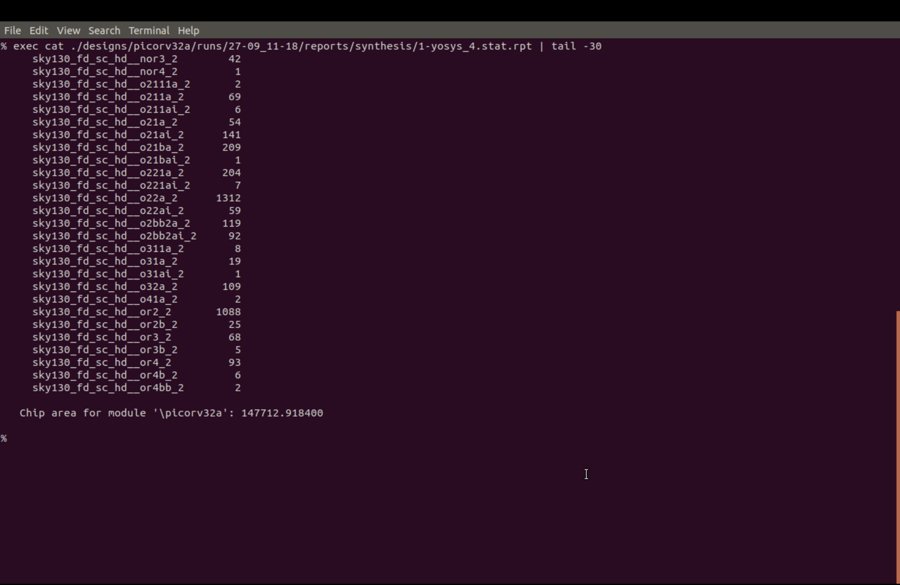
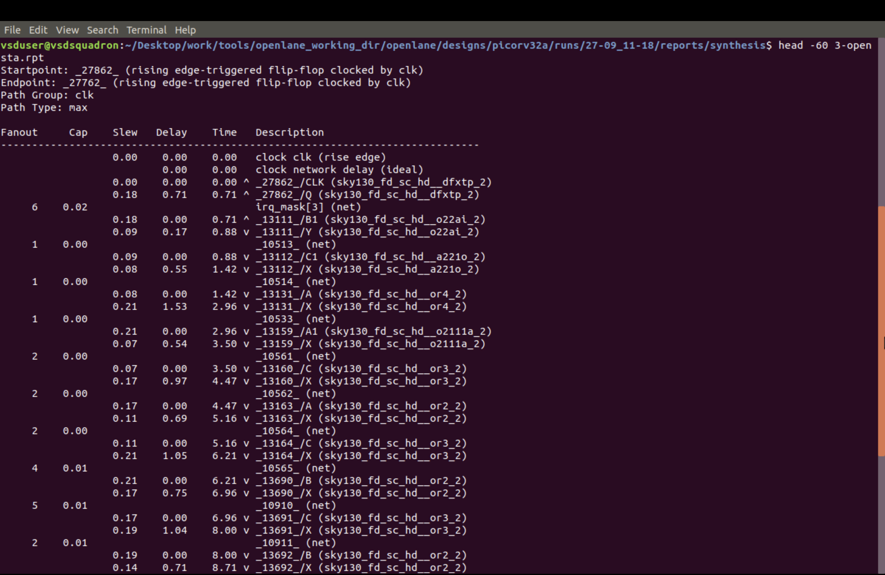
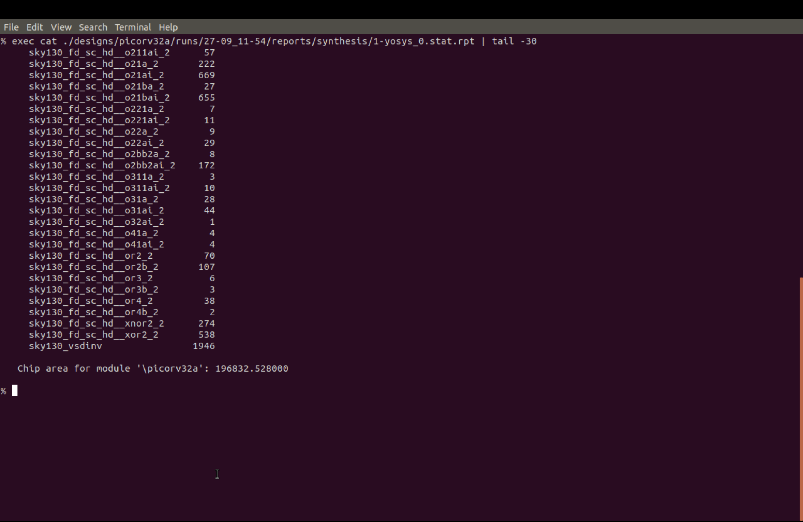
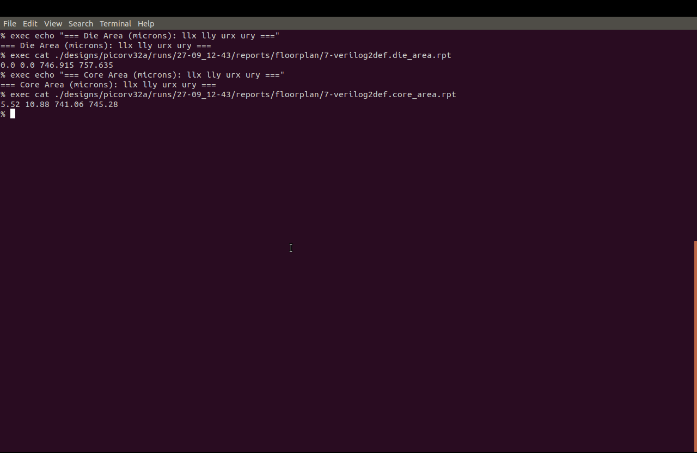
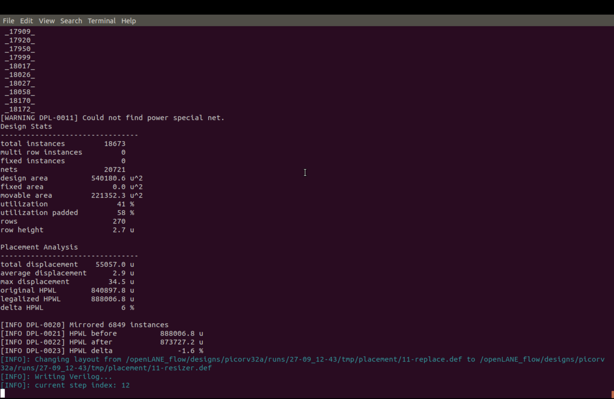
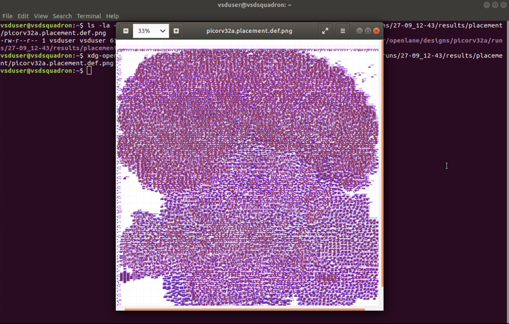

# Module 4: Pre-Layout Timing Analysis and Clock Design

This module documents the custom-cell integration and pre-route physical-design flow for the Sky130 `picorv32a` design. It covers custom inverter layout, LEF/Liberty integration, synthesis timing optimization, floorplanning, placement, ideal-clock static timing analysis (STA), clock-tree synthesis (CTS), and post-CTS timing checks.

> **Evidence note:** Treat the screenshots and reported measurements as evidence from the run they represent. Re-run the flow and replace or supplement screenshots if you need to document your own results.

## Objectives

- Understand how standard-cell timing models and delay tables are used before detailed routing.
- Relate placement-grid dimensions to routing-track dimensions.
- Create a custom Sky130 inverter layout and generate its LEF abstract.
- Integrate LEF and Liberty files into the OpenLane `picorv32a` flow.
- Compare synthesis timing and area before and after timing-oriented synthesis settings.
- Inspect a critical timing path and check timing through floorplanning and placement.
- Run ideal-clock STA, clock-tree synthesis, and post-CTS timing analysis.
- Review setup and hold timing, clock uncertainty, skew, and clock-tree behavior before routing.

## Workflow Overview

1. Custom inverter layout and LEF generation in Magic.
2. LEF and corner-specific Liberty integration into OpenLane.
3. Default synthesis and critical-path inspection.
4. Timing-oriented synthesis optimization.
5. Floorplanning and placement.
6. Ideal-clock STA, CTS, and post-CTS timing verification.

## 1. Custom Cell and OpenLane Integration

The first stage creates a custom inverter standard cell and makes its physical and timing views available to OpenLane.

1. Open `sky130_inv.mag` in Magic with the `sky130A.tech` technology setup.
2. Set the layout grid to `grid 0.46um 0.34um 0.23um 0.17um` and inspect the geometry against the intended track and placement-grid dimensions.
3. Check the cell terminals: `VPWR` is power, `VGND` is ground, `A` is the input, and `Y` is the output.
4. Generate the abstract with Magic's `lef write` command to produce `sky130_inv.lef`.
5. Copy the LEF and fast, slow, and typical Liberty files into `designs/picorv32a/src/`.
6. Update `config.tcl` with `EXTRA_LEFS`, `LIB_SYNTH`, `LIB_FASTEST`, `LIB_SLOWEST`, and `LIB_TYPICAL`.
7. Run `prep -design picorv32a` and check that the custom-cell abstract is included in `merged_unpadded.lef`.

The LEF provides the physical abstract, while the Liberty files provide timing and electrical models. Including these files in the configuration makes the views available to the design flow; it does **not**, by itself, prove that synthesis selected the custom inverter.

## 2. Synthesis and Timing Optimization

The default synthesis run is used as a baseline. The recorded OpenSTA report identifies a register-to-register maximum-delay path in the `clk` path group. The visible logic includes OR-family cells, and the lab notes describe a long OR-reduction chain along the critical path.

The timing-oriented run uses these settings:

```tcl
SYNTH_STRATEGY "DELAY 0"
SYNTH_BUFFERING 1
SYNTH_SIZING 1
```

### Recorded synthesis comparison

| Metric | Default synthesis | Timing-oriented synthesis |
|---|---:|---:|
| Reported chip area | `147712.9184` | `196832.528` |
| WNS | `-24.89` | `0.00` |
| TNS | `-759.46` | `0.00` |

These values are transcribed from the supplied lab notes and screenshots; confirm units and report context against the original run logs before using them in a formal report.

The comparison illustrates a common optimization trade-off: the recorded timing improved to zero WNS/TNS while the reported area increased. Results depend on the synthesis constraints, libraries, tool versions, and design configuration.

## 3. Floorplanning and Placement

The timing-optimized design is taken through `run_floorplan` and `run_placement`.

### Recorded floorplan dimensions

| Region | Lower-left coordinate (µm) | Upper-right coordinate (µm) |
|---|---|---|
| Die | `(0.0, 0.0)` | `(746.915, 757.635)` |
| Core | `(5.52, 10.88)` | `(741.06, 745.28)` |

### Recorded placement statistics

| Metric | Reported value |
|---|---:|
| Instances | 18,673 |
| Nets | 20,721 |
| Utilization | 41% |
| Padded utilization | 58% |
| Rows | 270 |
| WNS / TNS | 0 / 0, as recorded in the lab notes |

The placement image complements the text report by showing the placed standard-cell layout. The report also contains a warning that no power special net was found in the captured step. Interpret that warning in the context of the specific run configuration; do not automatically treat it as either a placement failure or proof that power-grid checks passed.

## 4. Ideal-Clock STA, CTS, and Post-CTS Timing

After placement, timing analysis progresses from a reference clock model to a synthesized clock network.

- **Ideal-clock STA:** evaluates timing before clock-tree insertion, using an idealized clock model.
- **Clock-tree synthesis (CTS):** builds and balances the clock-distribution network across sequential cells.
- **Post-CTS real-clock STA:** evaluates timing after clock-tree insertion, including clock insertion delay and skew effects.

The screenshots in this module document CTS execution, timing slack, clock-skew analysis, and the post-CTS real-clock report. A complete timing sign-off should also check setup and hold paths, clock uncertainty, generated clocks, and the required process/voltage/temperature corners. The screenshots alone should not be treated as proof of all-corner sign-off unless the corresponding reports are available.

## Screenshot Guide

Each image referenced below is expected to be stored alongside this README. If a filename differs in your directory, update the Markdown link to match the actual file.

### Custom Cell and OpenLane Setup

#### 1. `checking_inv_magic_layout.png` — Inspecting the inverter in Magic

The Magic window shows `sky130_inv` loaded. The console's `what` checks identify selected mask layers such as `nwell`, `poly`, `metal1`, `ndiff`, and `pdiff`. Use this as layout-inspection evidence before abstract generation.


#### 2. `sky130_inv_lef.png` — Generated LEF abstract

This image shows the LEF text for macro `sky130_inv`, including macro dimensions and physical pin shapes/directions for signal pins such as `A` and `Y`, together with power and ground pins.


#### 3. `config_tcl.png` — Original OpenLane configuration

This screenshot records the baseline `picorv32a` configuration. It shows the design inputs, a 5.000 ns clock period, and `clk` as the clock port/net.


#### 4. `config_extra_lefs_and_libs.png` — Adding LEF and Liberty views

The updated configuration adds an `EXTRA_LEFS` glob and points synthesis and corner-specific library variables to the Sky130 Liberty files.


### Synthesis and Timing Evidence

#### 5. `synthesis_before_fix_stats.png` — Default synthesis statistics

The recorded report gives chip area `147712.9184`. The lab notes record WNS `-24.89` and TNS `-759.46`, indicating that the default run did not meet the recorded timing target.



#### 6. `opensta_rpt.png` — Critical maximum-delay path

The terminal shows the beginning of an OpenSTA report with a register startpoint and endpoint, path group `clk`, and path type `max`. The visible logic includes OR-family cells. The accompanying notes attribute the critical delay to a long OR-reduction chain. This image is path-level evidence, not a complete setup-and-hold summary.



#### 7. `synthesis_after_fix_stats.png` — Timing-oriented synthesis result

This report records chip area `196832.528`. The run used `SYNTH_STRATEGY "DELAY 0"`, `SYNTH_BUFFERING 1`, and `SYNTH_SIZING 1`; the lab notes record WNS `0.00` and TNS `0.00`.



#### 8. `post_abc_mapped_statistics.png.png` — ABC-mapped cell statistics

This screenshot shows Yosys statistics after ABC mapping, including mapped Sky130 standard-cell types and counts. Keep the filename as shown if that is the exact name in your folder; otherwise correct both the file and this reference. The presence of a custom cell in the configuration does not establish that ABC selected it.


### Floorplan and Placement Evidence

#### 9. `floorplan_die_core_area.png` — Die and core dimensions

The terminal report gives the die boundary as `(0.0, 0.0)` to `(746.915, 757.635)` µm and the core boundary as `(5.52, 10.88)` to `(741.06, 745.28)` µm.



#### 10. `placement_design_stats.png` — Placement statistics

The report records 18,673 instances, 20,721 nets, 41% utilization, 58% padded utilization, and 270 rows. It also includes legalization and HPWL details and a warning about a missing power special net in this captured step.



#### 11. `picorv32a_placement_layout.png` — Rendered placement

This image shows the generated `picorv32a.placement.def.png` opened after placement and provides a visual complement to the placement statistics.



### Clock-Tree Synthesis and Post-CTS Timing

#### 12. `cts_tcl_run_cts.png` — CTS command and execution

This terminal screenshot captures the clock-tree synthesis command and the reported insertions or summary from the run.


#### 13. `cts_timing_slack.png` — Timing slack after CTS

This screenshot shows timing-slack information associated with the generated clock tree. Use the actual report values to decide whether the post-CTS paths meet their constraints.


#### 14. `cts_clock_skew.png` — Clock-skew analysis

This image records the clock-skew view for the synthesized clock network. Clock balancing and insertion delay can affect setup and hold timing.


#### 15. `post_cts_real_clock_sta.png` — Real-clock STA after CTS

This screenshot shows the post-CTS timing report using the real clock network, where insertion delay and skew are part of the timing evaluation.


#### 16. `tritoncts_stats.png` — TritonCTS statistics

This summary captures statistics from the CTS engine. Use the actual values shown in the image to describe the generated tree, buffer count, and clock-distribution result.


## Flow Summary

```text
Magic inverter layout
        ↓
LEF generation
        ↓
OpenLane LEF / Liberty integration
        ↓
Synthesis and timing optimization
        ↓
Floorplanning
        ↓
Placement
        ↓
Ideal-clock STA
        ↓
Clock-tree synthesis (CTS)
        ↓
Post-CTS timing verification
```

## Conclusion

This module follows the pre-route timing and clock-design flow for a Sky130 `picorv32a` design. It documents custom inverter integration, synthesis optimization, floorplanning, placement, clock-tree synthesis, and post-CTS timing analysis. The recorded synthesis comparison shows improved reported timing alongside increased area. Before claiming final timing closure, verify the actual setup and hold reports, clock constraints, and all required PVT corners.

