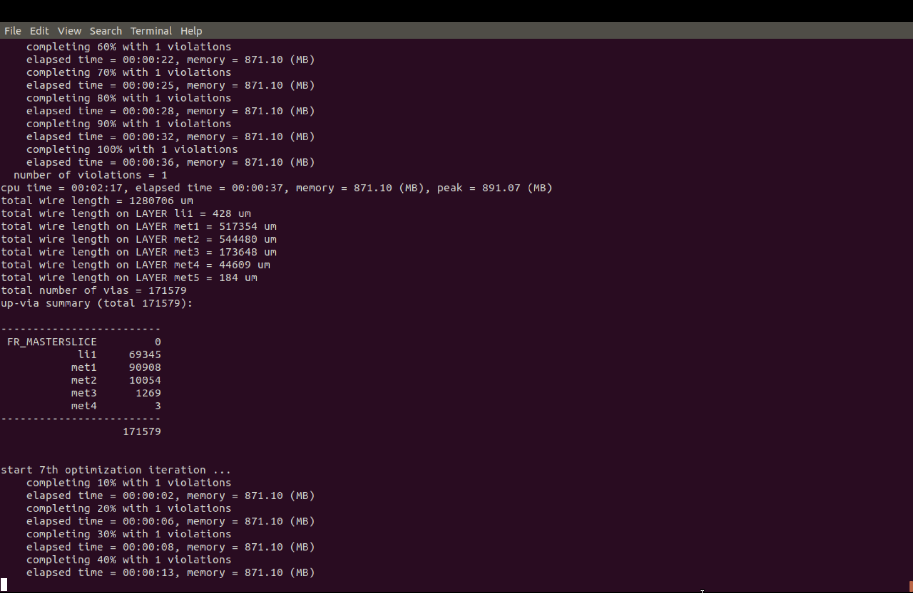
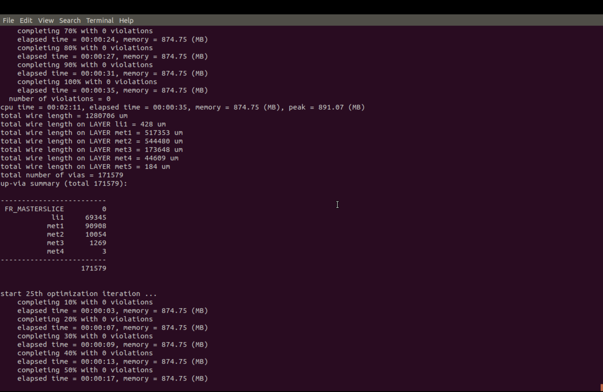
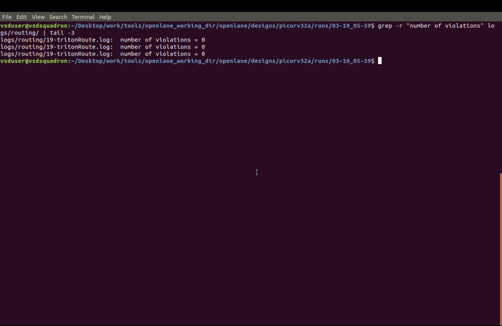
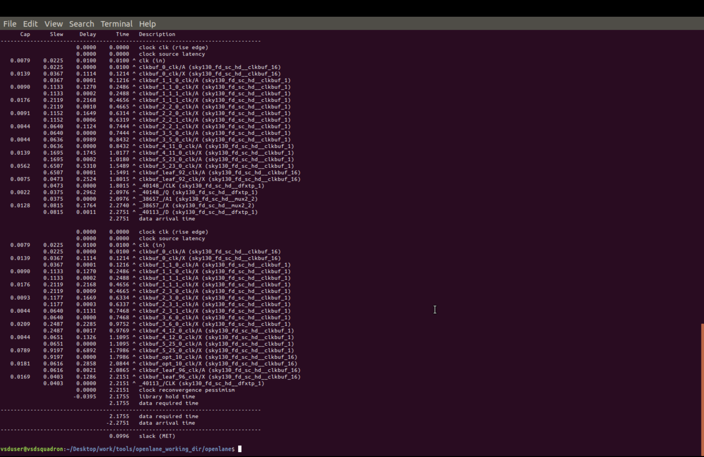
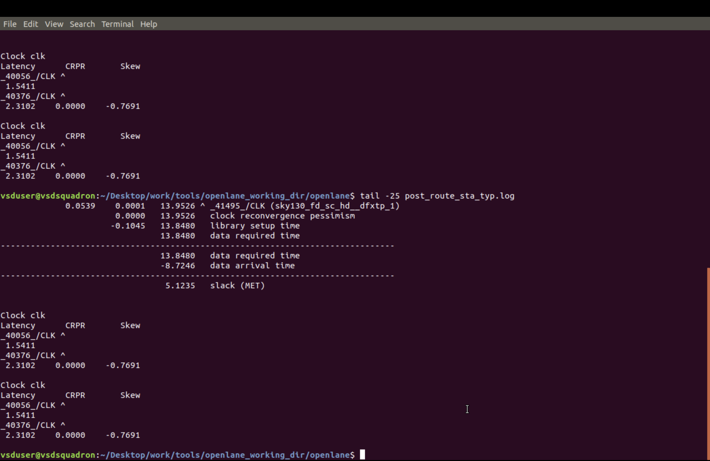
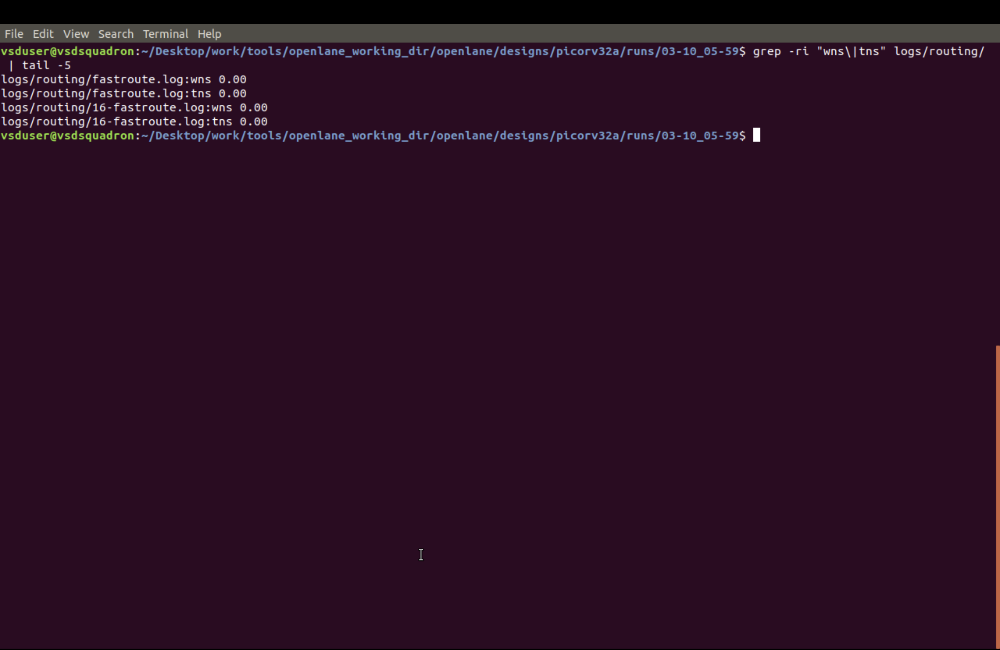
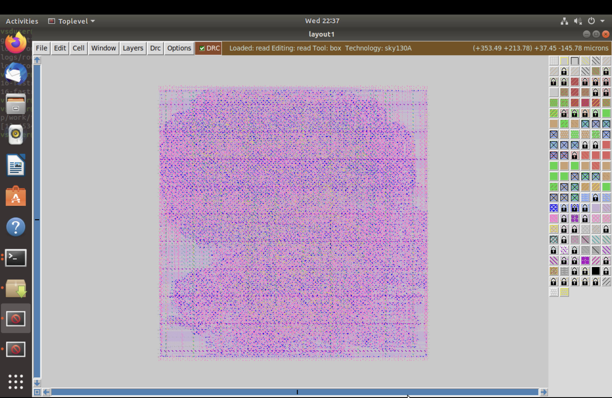
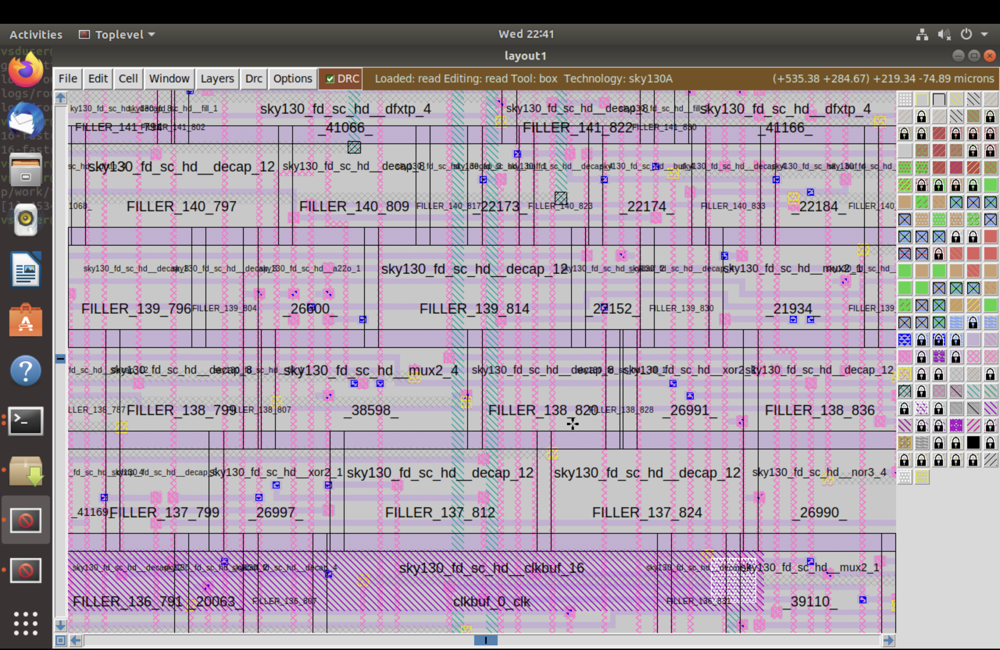

# Module 5: Routing and Post-Route Verification

This module continues the Sky130 `picorv32a` physical-design flow from Module 4. Placement and clock-tree synthesis (CTS) must already be complete before detailed routing begins. The screenshots here show the post-CTS timing setup, TritonRoute optimization progress and completion, routing-violation checks, post-route timing evidence, and inspection of the routed layout.

## What this module demonstrates

- How detailed routing progresses through iterative optimization.
- How to check TritonRoute violation counts and confirm routing completion.
- How to review timing reports after routing.
- How to inspect the routed design at both chip and local-cell scale.

The Module 5 directory does not include a power-distribution-network build or a separate global-routing setup screenshot. Those subjects may be part of the wider course, but the evidence below is specifically for detailed routing and post-route review.

## Read the images in implementation order

The filename numbering follows the design-flow sequence shown by the images, not their alphabetical filename order. Begin with the post-CTS timing context, then follow the routing run from an intermediate iteration through completion and checks, and finish with timing and layout inspection.

### 1. Establish the post-CTS timing context

#### `01_post_cts_sta_configuration.png` — STA setup before routing

This configuration loads the slow and fast Liberty libraries, reads the CTS netlist and the design SDC, marks clocks as propagated, and requests setup/hold path and clock-skew reports. It documents the timing-analysis context carried forward from CTS into the later physical-design checks; it is not itself a routing command.

### 2. Follow detailed routing as it iterates

#### `02_tritonroute_iteration_06.png` — Intermediate routing optimization

The TritonRoute log is partway through optimization. It shows the sixth iteration starting after an earlier iteration reported one violation. This is an intermediate state, not the final violation count.

#### `03_tritonroute_iteration_25.png` — Later routing optimization

This log has reached the twenty-fifth optimization iteration. The preceding iteration shown in the capture completed with zero violations; the twenty-fifth iteration is still in progress at the bottom of the screenshot. Use the completion and DRC captures below for the final recorded result.

#### `04_detailed_04_detailed_routing_completed.png` — Detailed routing finishes

This terminal capture reports that routing completed for `picorv32a` in `1h43m22s`. It also shows WNS and TNS as `0.00` in the displayed routing log. This is the run-completion checkpoint before reviewing the separately captured violation and timing summaries.

### 3. Check routing violations

#### `05_routing_violation_check.png` — TritonRoute violation count

The command searches the routing logs for the number of violations. The three displayed entries from `19-tritonRoute.log` each report `number of violations = 0`. This is the DRC/violation evidence captured for the routing run; it should not be confused with a separate foundry signoff DRC report.

### 4. Review post-route timing

#### `06_routing_wns_tns_log_query.png` — Routing-log WNS and TNS query

This screenshot runs a search for WNS and TNS in the routing logs. The displayed `fastroute.log` and `16-fastroute.log` entries report WNS `0.00` and TNS `0.00`.

#### `07_routing_wns_tns_repeated_query.png` — Repeated WNS and TNS query

Despite the `_typ` suffix, the screenshot content is the same routing-log WNS/TNS query and values as the previous image. It does not show a distinct typical-corner timing report, so it is included as duplicate evidence rather than interpreted as one.

#### `08_post_route_timing_path_slack.png` — Detailed timing path

This capture shows a timing-path report with clock-tree cells and a final slack marked `MET` at `0.0996`. It provides path-level timing evidence; the displayed slack belongs to this report and should not be conflated with the separate WNS/TNS grep output above.

#### `09_clock_skew_post_route_sta_log.png` — Clock skew and timing-log excerpt

This terminal screenshot shows clock latency, CRPR, and skew values, including skew `-0.7691`. It also shows a tail of `post_route_sta_typ.log` with a timing path marked `slack (MET)` at `5.1235`. These are the values visible in this capture; the screenshot does not identify this as a standalone final-corner summary.

### 5. Inspect the routed layout

#### `10_magic_full_routed_layout.png` — Full-design view in Magic

The full layout view shows the routed design loaded in Magic with the Sky130A technology and DRC display enabled. It gives a chip-level overview of the dense routed geometry.

#### `11_magic_zoomed_routed_layout.png` — Local routed-cell detail

This zoomed view shows individual standard cells, filler/decap cells, and routing shapes. Use it after the full-chip view to inspect how the routed geometry appears locally; it is a visual inspection, not a numerical DRC result.

## End-to-end sequence

`post-CTS timing setup` -> `TritonRoute iterations` -> `routing completion` -> `routing-violation check` -> `post-route timing review` -> `full and zoomed layout inspection`

## Result and interpretation

The captured route run completes, and the routing-log checks shown report zero violations and WNS/TNS of `0.00`. The images also preserve intermediate states (including an earlier iteration with one violation) and timing-path reports. Read those as different points and report types in the flow, rather than treating every screenshot as a final summary.
